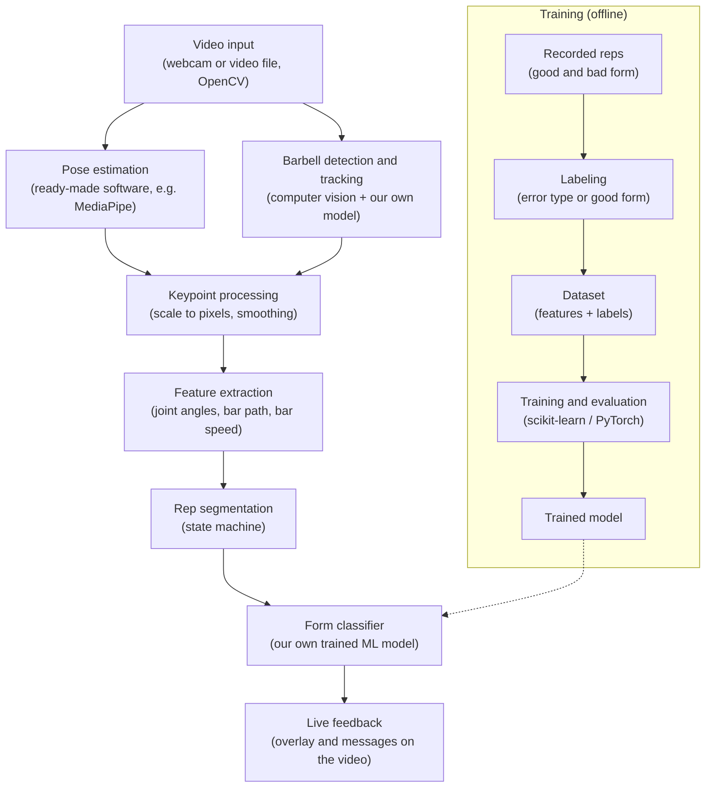

# deadliftguard

A real-time deadlift form checker built with computer vision and machine learning. Point a camera at the side of the lifter and the app tells you what to fix, based on body position and how the bar moves.

This is our project for the AI and Computer Vision course

## The idea

Bad deadlift form is easy to miss when you're the one lifting. We want an app that watches the lift and gives feedback on the spot: rounded back, hips shooting up too early, bar drifting away from the body, no full lockout, and so on.

## How it works



## Pipeline step by step

1. **Video input** - frames from a webcam or a recorded file (OpenCV). Recordings are also how we test things and build the dataset.
2. **Pose estimation** - body keypoints (hips, knees, ankles, shoulders...) from an existing pose estimation tool. We're not training this part.
3. **Barbell detection and tracking** - our own computer vision part: find the bar (or the plate) in the image and follow it frame by frame to get the bar path.
4. **Keypoint processing** - convert normalized coordinates to pixels, smooth the noise, deal with missing points.
5. **Feature extraction** - knee, hip and trunk angles, distance of the bar from the body, horizontal drift of the bar, speed in each phase.
6. **Rep segmentation** - split the movement into phases (setup, pull, lockout, lowering) and into single reps.
7. **Form classifier** - a model we train ourselves on our own recordings. It says whether a rep looks good and which mistake it contains.
8. **Live feedback** - draw the skeleton, bar path and short messages straight on the video.

## Tech

- Python, OpenCV, NumPy
- Pose estimation: ready-made tool (e.g. MediaPipe)
- Model training: scikit-learn, PyTorch
- Tests: pytest


## Repo structure (planned)

```
src/
  capture/        video input
  pose/           pose estimation
  barbell/        barbell detection and tracking
  analysis/       angles, features, rep segmentation
  training/       data preparation and model training
  app/            the live app
tests/            unit tests
docs/             notes and agreements (data formats, labels)
```

## Status

Work in progress. So far: joint angle calculation with tests.
